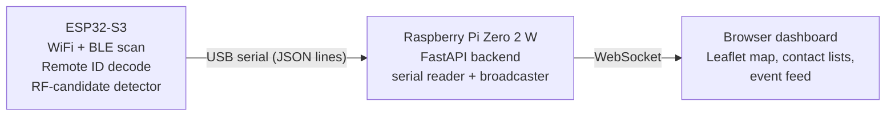

# Aerial Signal Monitor: Remote ID + RF Drone Detection

A passive drone-detection system built on an ESP32-S3 and a Raspberry Pi Zero 2 W. It listens for FAA Remote ID broadcasts, flags unidentified nearby RF transmitters that look like they are moving, and streams everything to a live web dashboard.

The system runs headless: power it on and the dashboard is served automatically, no laptop required.

---

## Credits and what's original

This project builds on open-source work, and I want that clear up front.

- **Firmware base:** the node-mode firmware (`firmware/src/main_remote.cpp`, `main_home.cpp`) comes from [colonelpanichacks/drone-mesh-mapper](https://github.com/colonelpanichacks/drone-mesh-mapper) (MIT), which itself builds on Remote ID firmware by Cemaxecuter / alphafox02 and on [JimZGChow/wifi-rid-to-mesh](https://github.com/JimZGChow/wifi-rid-to-mesh).
- **Remote ID decoding:** `opendroneid.c`, `opendroneid.h`, `odid_wifi.h` and `wifi.c` are unmodified files from the [OpenDroneID core library](https://github.com/opendroneid/opendroneid-core-c) (Intel and contributors, Apache-2.0).
- **My work:**

| Part | What it is |
|---|---|
| `firmware/src/main_remote.cpp` | Upstream firmware plus my **RF-candidate detector**: per-MAC signal-strength history, stationary-device suppression and a report cooldown, hooked into the WiFi and BLE callbacks and the output queue |
| `firmware/src/main.cpp` | An earlier experiment based on an older upstream version: mutexes around shared state, WiFi channel hopping and a first version of the RF-candidate logic. **Not part of the build** (excluded in `platformio.ini`) |
| `backend/dronepi_backend.py` | Original. FastAPI server, serial reader with auto-reconnect, WebSocket broadcast, the Leaflet dashboard and a simulated-flight generator |
| `systemd/dronepi.service` | Original. Starts the backend on boot |
| `firmware/src/main_home.cpp` | Upstream, unmodified. A mesh-to-USB bridge that I do not use in this setup |

Full license details are in [NOTICE.md](NOTICE.md).

---

## What it does

**Two detection layers:**

1. **Remote ID drones (confirmed aircraft).** The ESP32-S3 scans WiFi (NAN action frames and beacon vendor IEs) and Bluetooth LE for FAA-mandated Remote ID broadcasts and decodes them with OpenDroneID. These carry a real identifier, GPS position and altitude, so they plot at true coordinates with live flight trails.
   - *Limitation:* only aircraft that actually broadcast Remote ID are seen, generally those over 250 g. Non-broadcasting, sub-250 g and spoofed aircraft are invisible to this layer.

2. **RF candidates (unidentified transmitters).** Any WiFi or BLE device that does not decode as Remote ID but whose signal strength swings enough to suggest movement is flagged as a lead. This uses only a MAC address and signal strength, with no protocol decode.
   - *Limitation:* there is no bearing or true position. Range is a rough signal-strength estimate drawn as a ring around the sensor. A phone, laptop or any moving 2.4 GHz device looks the same, so these are leads, not confirmed aircraft.

---

## Architecture



- **Firmware** (`firmware/src/main_remote.cpp`): WiFi promiscuous capture and BLE scanning feed detections through a queue to a printer task that emits one JSON object per line over USB serial. The same Remote ID JSON is also written to a second UART (GPIO5/6) intended for a Meshtastic radio. That output is unused here and can be left unconnected.
- **Backend** (`backend/dronepi_backend.py`): reads the serial stream with auto-reconnect, parses each JSON line and broadcasts it to all connected browsers over WebSocket. It also serves the dashboard and a demo endpoint that injects simulated flights.
- **Dashboard:** a single-page Leaflet map with contact panels, vendor OUI lookup, randomized-vs-hardware MAC classification, signal quality, estimated range, first-seen and detection counts, filtering and sorting, delete controls, an event ticker and a demo control for launching simulated drones.

---

## Hardware

- Lonely Binary ESP32-S3 Gold Edition (ESP32-S3-WROOM-1, 16 MB flash, 8 MB PSRAM, built-in PCB antenna): the scanning node
- Raspberry Pi Zero 2 W: headless host for the backend
- USB cable from the ESP32-S3 to the Pi (power and data)

---

## Running it

### Firmware
From the `firmware/` folder, flash the ESP32-S3 with PlatformIO:
```bash
pio run -e remote_node -t upload
```
The `remote_node` environment builds `src/main_remote.cpp`. Editing `src/main.cpp` has no effect on the build.

### Backend (on the Pi)
```bash
python3 -m venv --system-site-packages ~/dronepi-env
source ~/dronepi-env/bin/activate
pip install fastapi uvicorn websockets pyserial
python -m uvicorn dronepi_backend:app --host 0.0.0.0 --port 8000
```
Run it from the folder that contains `dronepi_backend.py`. Set `SENSOR_LAT` and `SENSOR_LON` at the top of that file to the sensor's real location (this centers the candidate range rings), and check `SERIAL_PORT` (default `/dev/ttyACM0`).

### Auto-start on boot (systemd)
Edit `systemd/dronepi.service`: replace the `User=` value and the paths with your own. Then:
```bash
sudo cp systemd/dronepi.service /etc/systemd/system/
sudo systemctl enable --now dronepi
```

### View the dashboard
Open `http://<pi-ip>:8000` from any device on the same network. The server has no authentication, so keep it on a trusted network.

### Demo mode
Use the **Demo** control in the dashboard header to launch simulated drones, or visit `http://<pi-ip>:8000/test?count=5`. This tests the multi-drone tracking and dashboard without a real aircraft.

---

## Status and known limitations

**Verified:** the firmware builds and runs, JSON travels from serial to the dashboard over WebSocket, the dashboard works with simulated flights, and the backend starts on boot.

**Not yet done:**
- Live over-the-air testing against a real Remote-ID-broadcasting drone is still pending. I have not measured detection range, latency or the false-positive rate.

**Known issues in the current firmware:**
- **Fixed WiFi channel.** The built firmware listens on channel 6 only. Remote ID over WiFi NAN uses channel 6, but beacon-based Remote ID on other channels can be missed. The channel-hopping experiment lives in `main.cpp` and is not in the build.
- **Shared state is not locked.** The WiFi and BLE callbacks both update the aircraft and sighting tables without a lock. The plan is to have the callbacks only enqueue raw data and let one task own the tables.
- **Shared radio.** WiFi and BLE share one 2.4 GHz radio on the ESP32-S3, and the BLE scan pauses briefly each second, so the real miss rate needs measuring.
- **Untuned thresholds.** The RF-candidate movement threshold (a 20 dB signal-strength spread) was chosen by hand and has not been tuned against logged data.
- **Range.** Range is limited by the board's built-in PCB antenna. My estimate is tens of meters for BLE and up to about 150 m line of sight for WiFi; both are untested.
- The vendor OUI table is small and illustrative, not a full registry.

---

## Roadmap

1. Fix the shared-state race and add bounds checks in the packet parsing.
2. Add WiFi channel dwell and hopping to the built firmware.
3. Validate against a real Remote ID drone and add a results table (range, latency, false-positive rate).
4. Replace the hand-tuned RF-candidate threshold with a classifier trained on logged data.
5. Explore an optional camera node for visual detection fused with Remote ID by bearing.

---

## Legal note

This system is **passive**. It only receives publicly broadcast signals (Remote ID is designed to be publicly receivable, and WiFi/BLE advertisements are sent in the clear). It does not transmit, jam, decrypt or spoof anything. MAC addresses are personal data under some privacy regimes; if you deploy beyond personal testing, consider hashing stored MACs and check local and institutional policy.

---

## License

My original work is released under the MIT License (see [LICENSE](LICENSE)). Third-party components keep their own licenses; see [NOTICE.md](NOTICE.md).
